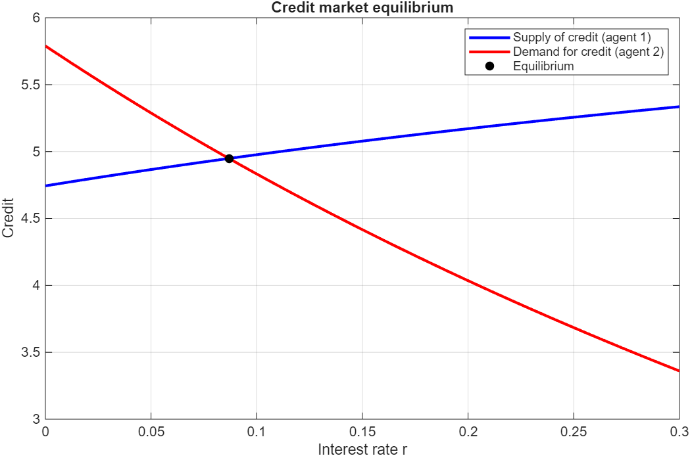
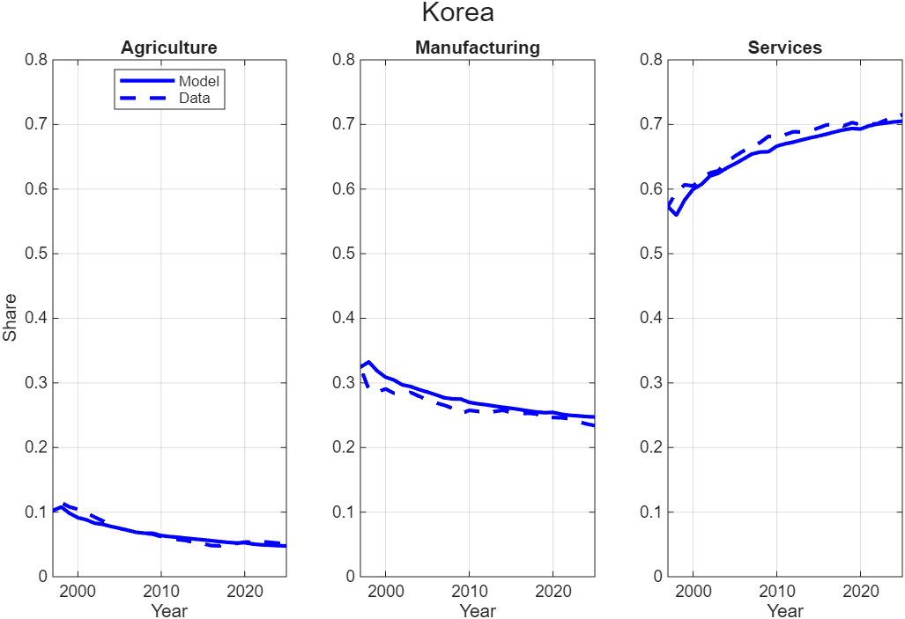

# Credit Markets and Structural Transformation — Quantitative Macroeconomics in MATLAB

> Master's degree group project — *N.F. and co-authors*
> All rights reserved. See `LICENSE` for details.

---

## Overview

Two small quantitative models, solved and simulated in MATLAB:

1. **Who sets the interest rate?** A two-period credit market with heterogeneous agents (lenders and borrowers). The equilibrium interest rate clears the market for savings, and we study how it reacts to patience, income today and income tomorrow, and to the mix of savers and borrowers in the economy.
2. **One model, two countries.** A static model of sectoral composition with non-homothetic CES preferences, calibrated on **South Korea** (high income) and **Turkey** (upper-middle income) with World Bank employment shares in agriculture, industry and services. We compare the two economies at the same stage of development (Korea 1997 and Turkey 2025, about 15,800 USD per capita) and then feed the model the observed GDP per capita path, 1992–2025, to see how much of the structural transformation income growth alone can explain.

The full write-up, with derivations and discussion, is in [`report/problem_set_1_report.pdf`](report/problem_set_1_report.pdf). In the report the scripts keep their original names: `ex1a`–`ex1c` = `a1`–`a3`, `ex2a`–`ex2b` = `b1`–`b2`.

---

## Project Structure

```
.
├── a1_credit_market_equilibrium.m              # Equilibrium with one lender and one borrower
├── a2_credit_market_experiments.m              # One experiment at a time vs the base case
├── a3_credit_market_many_agents.m              # Many agents and the share of lenders
├── b1_static_calibration_korea_turkey.m        # Static calibration: Korea 1997 vs Turkey 2025
├── b2_structural_transformation_korea_turkey.m # Dynamics: income follows GDP per capita in the data
├── report/problem_set_1_report.pdf             # Full report (21 pages, authors as initials)
├── figures/                                    # Figures used in this README
├── data_korea_turkey.xlsx                      # WDI data, 1992–2025
└── solve_consumption_foc.p                     # Compiled helper: FOC system of the consumer (course material)
```

Scripts starting with `a` belong to Part A (credit market), scripts starting with `b` to Part B (structural transformation).

---

## Part A — Credit market equilibrium

Each agent lives two periods, receives incomes w1 and w2, and chooses how much to save at the interest rate r:

$$
\max_{c_1, c_2} \; \ln c_1 + \beta \ln c_2
\quad \text{s.t.} \quad
c_2 = w_2 + (1+r)(w_1 - c_1)
$$

Optimal saving is increasing in r:

$$
s_i(r) = \frac{\beta_i w_{1,i}}{1+\beta_i} - \frac{w_{2,i}}{(1+\beta_i)(1+r)}
$$

The market clears when total saving is zero, which gives a closed form for the equilibrium rate:

$$
1 + r^* = \frac{\sum_i N_i \, w_{2,i}/(1+\beta_i)}{\sum_i N_i \, \beta_i w_{1,i}/(1+\beta_i)}
$$



Base case (lender / borrower: β = 0.95 / 0.90, w1 = 15 / 10, w2 = 5 / 20): r* = 0.0868, credit = 4.95.

`a2_credit_market_experiments.m` changes one characteristic at a time (set `experiment` to 1, 2 or 3 at the top of the script) and plots supply and demand of credit against the base case:

| Experiment | r* | Credit |
|---|---|---|
| 1. Borrower more patient (β = 0.95) | 0.0526 | 4.87 |
| 2. Borrower richer today (w1 = 15) | −0.0918 | 4.48 |
| 3. Lender richer tomorrow (w2 = 15) | 0.5126 | 2.22 |

With many agents, the level of r* depends only on the **share** of lenders, not on the size of the economy: moving the share of lenders from 10% to 90% lowers r* from about 0.95 to about −0.52.

---

## Part B — Sectoral composition in Korea and Turkey

Preferences over agriculture, manufacturing and services are CES with non-homothetic terms (negative for the necessity, positive for the luxury):

$$
U = \left[ \sum_{i \in \{a,m,s\}} \omega_i^{1/\varepsilon} (c_i + \bar{c}_i)^{(\varepsilon-1)/\varepsilon} \right]^{\varepsilon/(\varepsilon-1)}
$$

The non-homothetic terms are common to the two countries (estimated on Korea, 1992–2025); the weights ω are calibrated so that the model matches each country exactly at the comparable stage:

| | GDP per capita (2015 USD) | Agriculture | Industry | Services |
|---|---|---|---|---|
| Turkey 2025 | 15,883 | 14.2% | 27.3% | 58.5% |
| Korea 1997 | 15,682 | 10.2% | 32.4% | 57.3% |

In the dynamic part the model is solved year by year with `fsolve`, with income equal to observed GDP per capita, and the simulated shares are compared with the data.



---

## Data

World Bank, *World Development Indicators* (CC BY 4.0): `NY.GDP.PCAP.KD` (GDP per capita, constant 2015 USD) and `SL.AGR.EMPL.ZS`, `SL.IND.EMPL.ZS`, `SL.SRV.EMPL.ZS` (employment shares, modeled ILO estimates).

---

## Requirements

- MATLAB R2020a or later, with the Optimization Toolbox (`fsolve`)
- `solve_consumption_foc.p` must stay in the same folder as the Part B scripts: it is a pre-compiled helper provided with the course and cannot be inspected

## Usage

Each script is self-contained: open the repository folder in MATLAB and run any `.m` file. In `a2_credit_market_experiments.m` choose the experiment at the top of the script.

---

## License

This project is protected by copyright. See the [`LICENSE`](LICENSE) file for full terms.
**Reusing, copying, modifying, or redistributing** the code without explicit written permission from the authors is not permitted.
